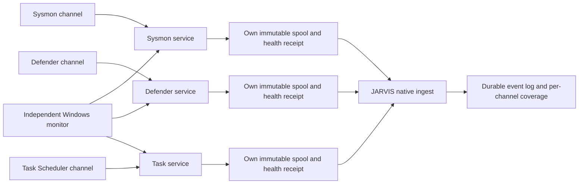

# Native collector uptime architecture

Status: source implementation prepared 2026-09-25; protected Windows stage
verified, services not installed or validated. Baseline measured 2026-09-24.

## Implementation invariants (2026-09-25)

- One publisher per channel. A channel-specific process lock and an explicit
  service-to-channel allowlist reject duplicate or mismatched publishers.
- Every publisher continues the existing sensor identity, channel sequence,
  generation, and record-ID bookmark in the existing spool. No migration may
  clear, replace, or silently rewind a batch or acknowledgement.
- Each channel writes its own atomic health receipt. Missing, stale, failed,
  or conflicting receipts mean unavailable coverage; an aggregate health flag
  cannot make an individual channel healthy.
- A blocked read, crash, or exhausted restart budget for one channel must not
  prevent the other channels from producing and retaining evidence.
- Capacity, retry, and cleanup remain bounded per channel. No unacknowledged
  batch is removed, and any cursor uncertainty or publication interruption
  stays visible until reconciled.
- Installation preserves the old executable, service configuration, identity,
  spool, and ACLs for rollback. Cutover stops the old publisher before starting
  a replacement; rollback stops replacements before starting the old service.
- Windows sleep and WSL interop outages remain explicit blind spots. Native
  channel isolation alone does not restore the WSL collectors that query
  Windows through PowerShell.

## Why this is needed

The current Windows sensor is one service with one loop reading Sysmon, Defender,
and Task Scheduler in sequence. It can continue collecting when WSL stops while
Windows remains awake. It uses immutable per-channel batches, but a slow Sysmon
Event Log read delays the other channels. In the last 24 hours, JARVIS recorded
577 complete, 155 partial,
and 3 unavailable `native` receipts. A live partial receipt named a Sysmon
`EventLogException` timeout. A later complete receipt proves recovery for that
pass, not sustained uptime. After fresh audits the host score moved between
56 and 73; the latest read at 2026-09-24 08:40 local was 73 with 100% scored
collector coverage, complete native delivery, and healthy service checks.
Intermittent native failure and independent-monitor lag can still make it
fluctuate. BitLocker is already credited separately.

## Designs considered

| Design | Fault isolation | Operational cost | Decision |
| --- | --- | --- | --- |
| One sequential service with bounded retries and SCM recovery | A timeout is bounded, but all channels still share the loop and process | Small | Interim mitigation only |
| One service with a thread per channel | Channels can progress independently until a thread wedges; .NET cannot safely kill that thread | Medium, shared state races | Reject |
| One supervisor service with a child process per channel | Process isolation and one SCM registration | Custom child lifecycle, job-object cleanup, restart policy | Reserve if multiple SCM services prove unmanageable |
| One SCM-managed service per channel | A stuck or crashed reader cannot stop the other two while Windows is awake | Three service registrations and careful migration | Select |

Jev (`jev-1.13.0`) reviewed only aggregate receipt counts, architecture
descriptions, and safety requirements. Its Choice selected separate services:
probability 0.65, confidence 0.52; supervisor with children was 0.35. Its Noul
probability that bounded retries alone isolate the channels was 0.10. These are
advisory judgments, not validation or authority to install services. The
deterministic reason for the selection is process-level isolation under the
Windows Service Control Manager (SCM), with no WSL dependency while Windows
itself is awake.

## Target structure

Each service runs under its own virtual service identity with access to only
its Event Log channel and spool directory. It owns one channel's cursor,
sequence allocation, heartbeat, capacity budget, and acknowledgements. The
ingester composes channel states; a healthy Defender channel must remain
healthy and ingestible when Sysmon fails. A shared aggregate health flag must
never replace the three independent receipts. The WSL scheduler's existing
leases, freshness checks, and score gates remain evidence consumers, not
Windows service supervisors.

The Windows monitor checks each channel's service state and heartbeat, even
while WSL is down. SCM handles crashes with bounded restart policy. A channel
watchdog may restart a service only after repeated stale heartbeats and a
recorded attempt; it must stop after a small fixed budget and alert the owner.
An Event Log read timeout first gets a bounded retry. Persistent timeouts,
spool corruption, unacknowledged capacity exhaustion, or an uncertain cursor
remain visible failures. No recovery action deletes batches, rewinds a cursor,
clears a finding, or claims missing events were observed.

Host sleep is a separate boundary. Modern Standby can pause collection even
when Windows services are installed; no in-process watchdog can run while the
machine is actually suspended. On wake, compare the last channel bookmark
with the oldest and newest retained Event Log records, drain what remains,
and record exact lost ranges. The owner decides whether to change sleep
settings for overnight observation; JARVIS does not silently keep the device
awake.

## Cutover without losing events

1. Build and test a single-channel executable and installer in an isolated
   environment. Preserve the deployed binary, service configuration, spool,
   and hashes before changing Windows services.
2. The first cutover stops the legacy three-channel publisher, changes its
   startup to manual, and activates all three isolated publishers. The legacy
   binary has no per-channel disable switch, so a sequential live migration
   would require an additional hybrid publisher mode and repeated restarts.
   The all-channel stop has a short observation gap, but avoids two publishers
   allocating the same sequence. The installer restores the old publisher if
   any new channel fails its first receipt, service identity, or cursor check.
   A channel-by-channel migration becomes possible only after a separately
   validated hybrid mode exists; use it if the bounded first cutover fails.
3. Retain the old channel's `sensor_id`, `device_id`, generation, last published
   sequence, and record-ID bookmark for the new publisher, or write an
   explicit authenticated migration receipt and make the ingester reconcile
   the new identity before it accepts data. Do not silently reset a cursor.
4. Keep the existing batch files and acknowledgements. Only the owning
   channel service may compact its directory, after exact digest
   acknowledgement; set capacity limits per channel so one busy stream cannot
   fill another stream's budget.
5. Verify each first new batch continues the last old sequence and generation
   (or records an explicit gap), compare channel health and event delivery,
   and record any overlap or gap. Rollback stops all new publishers before
   restoring the saved legacy binary and service. A rollback must reconcile
   each channel's latest new batch with the old publisher's resume point.
   Do not call the migration complete until this readback and the soak gates
   below pass.

## Acceptance gates

- Isolated tests: one reader blocks or crashes while the other two continue;
  repeated timeout remains unavailable; service restart resumes the exact
  cursor; log reset and wrap retain explicit gap evidence; power loss during
  publication leaves either a complete immutable batch or no publication.
- Windows integration: each service's identity, ACLs, SCM recovery, heartbeat,
  and rollback are read back from the installed machine. The owner can see
  which channel failed and which recovery attempt was made.
- Ingest: no duplicate sequence accepted, no missing range called clean,
  unacknowledged batches retained, and all eight telemetry stages reported
  per channel. WSL sleep must not stop Windows collection.
- Runtime: compare per-channel receipts against the 577/155/3 baseline,
  verify a fresh 15-minute complete awake window with no unaccounted gap,
  then a 24-hour soak including suspend/resume and reboot. A successful build, Jev
  judgment, or one clean pass does not satisfy these gates.

All live service, Windows, loopback, and Jev checks run through the permitted
host execution path outside the restricted sandbox. Sandbox denial is not
service evidence. Protected service installation and Windows policy changes
still require their normal authority, backup, effective readback, and rollback.

## Immediate bridge

`windows-sensor/JarvisSensor.cs` now has a source-only bounded retry for the
specific Windows Event Log timeout code. It compiled with the installed .NET
Framework compiler. The isolated test harness compiled, but Windows denied
execution of that temporary unsigned binary; the change is not installed.
The existing service and score must still be judged from its live receipts.

## Source implementation and gate status, 2026-09-25

The source now has three allowlisted SCM service modes, one per Event Log
channel, with separate process locks and health receipts. The existing
512 MiB spool budget is split into 384 MiB for Sysmon and 64 MiB for each
other channel. A live read found approximately 193 MB of Sysmon batches,
0.4 MB of Defender batches, and 15 MB of Task Scheduler batches; equal shares
would have stopped Sysmon at cutover. The installer remeasures before switching
and refuses a channel over budget without deleting evidence. The schema-2 batch format, sensor/device
identity, sequence, generation, and record-ID bookmark remain unchanged. A
mode marker prevents the replacement legacy binary from publishing during
isolated operation. The ingester composes the three receipts, refuses identity
disagreement, and exposes eight stages per channel. A protected Windows task
has a two-strike, two-attempt-per-hour restart budget and writes intent before
action. Its self-test exercised threshold, exhaustion, interruption-relevant
intent persistence, and repeated atomic receipt replacement.

The reviewed source bundle is staged at
`/tmp/jarvis-native-isolation-20260925` with SHA-256 values in
`SHA256SUMS.json`. The installer accepts only a copy under the
administrator-controlled `C:\Program Files\Jarvis\SensorStage`. It backs up
the old binary, identities, service definition and ACLs, then checks the first
new batch and effective service identity. Rollback stops all new publishers,
checks each latest cursor, restores the binary and ACLs, and requires a fresh
legacy receipt. The cutover attempts below were run on the protected host.

Validation: the .NET Framework source compiled; both PowerShell scripts
parsed; the monitor self-test passed; 52 focused Python tests passed after the
per-channel telemetry addition. The required full 1,554-test suite passed
outside the restricted sandbox. The first sandbox run produced EROFS scratch
errors and misleading ownership failures, so it is not the acceptance result.
Jev's metadata-only Choice concentrated 0.63 on the soak gate (confidence
0.50) and its Noul probability that source checks prove live protection was
0.03; neither judgment authorizes cutover.

The live pre-cutover baseline is not ready. On 2026-09-25, `/api/health`
returned 200 with `native` and `bridge` complete, while the last fresh
coverage audit still named 11 high-severity failed or stale collectors. Five
Windows interop failures predated the current service start; a bounded retry
was queued for each, and the later `intrusion` receipt completed. The native
job retained two low-severity Sysmon loss findings. These remain in the written
baseline; no finding was suppressed. Establish fresh complete receipts before
the Windows service cutover. After switching, verify installation and ACLs,
then a 15-minute complete awake window and the 24-hour suspend/reboot soak.
CPU, memory, disk, latency and battery costs remain unmeasured.

The three-file ingester/telemetry runtime release was staged from the sealed
running source at `~/.cache/jarvis-release-staging/20260925T135042Z-on-16b53e695072`.
Its three overlaid file hashes matched the reviewed checkout. The `sudo`
deploy attempt stopped at authentication before switching releases; the owner
was given the exact `--expect-base --skip-tests` command to run at a terminal.
The hash-verified Windows bundle was copied through normal UAC into
`C:\Program Files\Jarvis\SensorStage`, where ACL readback showed only SYSTEM
and Administrators with write access and Users with read/execute access.

## Cutover attempts, 2026-09-25

Three UAC-run attempts each failed a gate and rolled back. The isolated mode
is not active and the legacy publisher is the only writer.

1. `sc.exe config ... password= ""` failed: Windows PowerShell 5.1 drops the
   empty native argument. SCM accepted the virtual account with the password
   option omitted. This was read back on the stopped service first. Rollback
   succeeded after a fix for the missing monitor task.
2. Stopping the legacy service interrupts its sequential pass. The final
   aggregate receipt then lacks the channels it did not reach. The installer
   now keeps the complete pre-stop receipt and continues from each channel's
   immutable highest batch. Identity mismatch and sequence rewind are rejected.
   Rollback succeeded.
3. The service account, logon right, ACLs and all three services worked. Each
   channel's batch chain stayed contiguous across legacy, isolated and legacy
   again: Sysmon 32944-33014, Defender 3610-3622, Tasks 14676-14721. There were
   no generation breaks and no gap flags. `schtasks /create /tr` then failed
   with E_FAIL (-2147467259): PS 5.1 split the quoted `Program Files` path.
   This was reproduced with a disposable user task. During rollback, the
   restarted legacy binary took each isolated `health.json` as its latest
   batch. It orders every `*.json` by name. It reported all channels
   unavailable (`KeyNotFoundException`). A separate elevated repair moved the
   three receipts into the rollback baseline and set the isolated services to
   demand start. Legacy receipts were complete within one pass. Native
   ingestion was then FRESH, with `/api/health` native and bridge complete.
   The protected channels were blind for about three minutes. Windows kept
   the events and the cursors caught up.

Attempts 4 and 5, at 22:33 and 22:38 local, both stopped at the first
pre-flight check. No changes were made. A `geo3d` asset build held the load
average near 20 on 4 CPUs. Under that load the legacy Sysmon read timed out on
6 of 33 passes, although its sequence stayed contiguous. The installer read a
single receipt snapshot, and each time that snapshot showed Sysmon
unavailable. The pre-flight now polls for up to 90 seconds. It accepts only a
receipt under 30 seconds old in which every channel is present and available.
Run read-only against the live receipt, it accepted one within 1 second.

Attempt 6, at 22:50 local, got past the pre-flight, the SYSTEM task
registration and fresh receipts from all three services. Each chain stayed
contiguous: Sysmon 33941-33994, Defender 3709-3713, Tasks 15091-15110. It
then failed the monitor check. Task Scheduler queued the monitor at
22:51:25.6 but created its SYSTEM process only at 22:51:53.98. The pass wrote
`monitor.json` at 22:52:00, about 2 seconds after the installer's 30-second
wait ended. Rollback then ran without manual repair. It preserved the three
isolated receipts and restarted legacy with every channel complete. The
monitor wait is now bounded at 180 seconds. It accepts only a receipt written
after this task start, in which the monitor judged every service complete. The
post-start per-channel status check samples the same way as the pre-flight.

The installer now registers the monitor with `Register-ScheduledTask`. Rollback
moves non-batch receipts out of channel directories before starting legacy. It
demotes the isolated services as soon as they stop. The `-SelfTest` path runs
the real functions in Windows PowerShell, and `tests/test_native_isolation.py`
invokes it. A mutation that copies instead of moving receipts fails it. Still
not exercised live: task registration as SYSTEM, the monitor receipt wait, and
the post-start service identity readback. Jev's metadata-only Choice gave 0.64
to the post-start checks (confidence 0.52). Its Noul that a failed fourth
attempt would roll back without manual repair was 0.43. Neither is authority.
